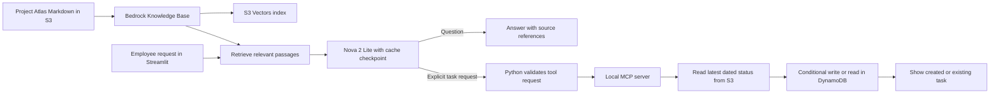

# AWS Bedrock AI | Project Atlas Employee Assistant

A fictional employee assistant that answers questions about a project pilot and creates internal follow-up tasks. It demonstrates retrieval-augmented generation (RAG), Amazon Bedrock prompt caching, model-selected MCP tools, and duplicate-safe task creation with AWS services.

Project Atlas, its documents, and its tasks are fictional. This is an independent portfolio project.

## What the app does

1. Retrieves relevant Project Atlas passages from an Amazon Bedrock Knowledge Base backed by Amazon S3 Vectors.
2. Sends those passages to Amazon Nova 2 Lite to answer questions with numbered source references.
3. Adds a prompt cache checkpoint after the retrieved context. Bedrock may reuse eligible cached input on a later request.
4. Lets Nova 2 Lite request a local MCP tool when the user explicitly asks to create a task. Python checks the tool request before execution.
5. Reads the latest dated Project Atlas status document from S3, selects the earliest due open action, and creates or returns its internal DynamoDB task.
6. Shows whether the task was newly created or already existed.

## Architecture



The question path uses RAG: the Knowledge Base retrieves passages, and Nova 2 Lite produces an answer grounded in them. The task path uses a local MCP tool. Task creation reads the current status directly from S3, so it does not rely on a possibly stale retrieved passage. A conditional DynamoDB write prevents duplicates for the same action ID. The app does not email employees or mark the underlying work complete.

## Components

| Component | Purpose |
| --- | --- |
| Streamlit | Local employee interface |
| Amazon S3 | Stores fictional Project Atlas Markdown documents |
| Bedrock Knowledge Base | Retrieves relevant document passages |
| Titan Text Embeddings V2 | Embeds document chunks during ingestion |
| Amazon S3 Vectors | Stores and searches embeddings |
| Nova 2 Lite through Bedrock Converse | Produces answers and selects the task tool |
| Bedrock prompt caching | Makes a stable input prefix eligible for reuse |
| Local MCP Python server and client | Exposes the internal task action |
| Amazon DynamoDB | Stores tasks using duplicate-safe conditional writes |

The Python clients use `ap-southeast-2` (Sydney). Nova 2 Lite uses a global inference profile, which may route inference outside Sydney. Use fictional data for this demonstration.

## Prerequisites

- Python 3.13, Git, and the AWS CLI.
- An AWS profile permitted to use the Bedrock models and resources below.
- Bedrock model access for Nova 2 Lite and Titan Text Embeddings V2.
- A globally unique S3 bucket name for the source documents.

Keep AWS credentials out of the repository.

## Set up AWS resources

1. Create an S3 bucket in Asia Pacific (Sydney). Upload the four files in `knowledge/` under the `project-atlas/` prefix:

   ```bash
   aws s3 sync knowledge/ s3://YOUR_SOURCE_BUCKET/project-atlas/ \
     --exclude "*" --include "*.md" \
     --profile YOUR_AWS_PROFILE --region ap-southeast-2
   ```

2. In the Bedrock console, create a Knowledge Base with an S3 data source at `s3://YOUR_SOURCE_BUCKET/project-atlas/`. This pilot used Titan Text Embeddings V2, 1024-dimensional floating-point embeddings, and quick-created S3 Vectors storage. Sync the data source after creation and whenever a source document changes. Record the Knowledge Base ID.

3. Create a DynamoDB table in Sydney with the string partition key `action_id` and on-demand billing:

   ```bash
   aws dynamodb create-table \
     --table-name project-atlas-actions \
     --attribute-definitions AttributeName=action_id,AttributeType=S \
     --key-schema AttributeName=action_id,KeyType=HASH \
     --billing-mode PAY_PER_REQUEST \
     --profile YOUR_AWS_PROFILE --region ap-southeast-2
   ```

Wait until the table is `ACTIVE`. The AWS profile needs permission to retrieve from the Knowledge Base, invoke Nova 2 Lite, read the source S3 objects, and read/write the DynamoDB table.

## Run locally

From the repository folder:

```bash
python3 -m venv .venv
source .venv/bin/activate
python -m pip install -r requirements.txt
aws login --profile YOUR_AWS_PROFILE --region ap-southeast-2

AWS_PROFILE=YOUR_AWS_PROFILE \
BEDROCK_KNOWLEDGE_BASE_ID=YOUR_KNOWLEDGE_BASE_ID \
ATLAS_SOURCE_BUCKET=YOUR_SOURCE_BUCKET \
ATLAS_ACTIONS_TABLE=project-atlas-actions \
python -m streamlit run app.py
```

Replace the placeholders with your own values. The local MCP subprocess inherits these environment variables. The S3 source bucket and DynamoDB table names are configurable; the Python code currently fixes the AWS Region to Sydney.

## Try the demo

Enter these fictional requests in the Streamlit app:

- **Question:** `What remains outstanding before the Project Atlas pilot can launch?` Expected: three blockers from the current status, with source references. No task is created.
- **Task:** `Create an internal task for the next open Project Atlas action.` Expected: an IT task for testing sign-in for the remaining 12 volunteers, due 27 October 2026. If that task is absent, the request creates it. If it already exists, the app returns it and says no duplicate was created.

The current task path accepts explicit requests beginning with `create ` or `please create ` and containing `task`. The latest dated status document must contain action IDs, owner teams, and due dates in the format shown in `knowledge/project-atlas-status.md`.

## What to inspect while learning

- **RAG:** `rag_client.py` calls the Knowledge Base Retrieve API. `agent_client.py` puts the returned passages in the model request. The app displays their S3 source URIs so you can check the model's numbered references.
- **Prompt caching:** `agent_client.py` places a `cachePoint` after the retrieved context and prints Bedrock usage. Compare `cacheWriteInputTokens` on an eligible first call with `cacheReadInputTokens` on a repeated call. A cache hit is not guaranteed. See [AWS prompt caching documentation](https://docs.aws.amazon.com/bedrock/latest/userguide/prompt-caching.html).
- **MCP and actions:** `mcp_server.py` exposes the tools; `mcp_actions_client.py` calls the task tool; `action_workflow.py` parses the latest S3 status; and `actions_client.py` creates or retrieves the DynamoDB task.

## Cost and cleanup

This demo can incur charges for model inference, embeddings and ingestion, S3 Vectors, S3 storage and requests, and DynamoDB operations. Cache writes and reads can have different rates from uncached model input. Review current [Bedrock pricing](https://aws.amazon.com/bedrock/pricing/), [S3 pricing](https://aws.amazon.com/s3/pricing/), and [DynamoDB pricing](https://aws.amazon.com/dynamodb/pricing/) for your Region and account before extended use. AWS credits and eligibility vary by account.

When finished, remove the demo Knowledge Base and its vector resources, source S3 objects and bucket, and DynamoDB table through the AWS console. Check the resource lists and billing page afterward; deleting the Knowledge Base may not remove every associated resource.

## Limits

- The assistant uses fictional documents and runs locally. It does not connect to a real employee directory, ticketing system, or messaging service.
- The model can produce an inaccurate answer or citation; check claims against the displayed sources.
- The action parser expects the documented status format. It does not accept arbitrary prose or automatically close tasks when a newer status changes.
- Creating a task does not mean the underlying action is complete.
