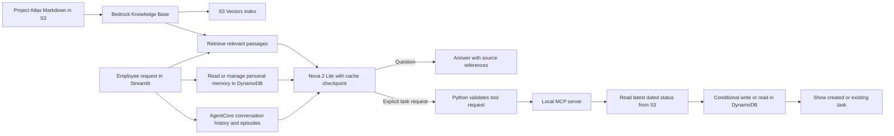

# AWS Bedrock AI | Project Atlas Employee Assistant

A fictional employee assistant that answers questions about a project pilot, keeps conversation history, recalls selected past interactions, learns limited personal facts, remembers a response preference, and creates internal follow-up tasks. It demonstrates retrieval-augmented generation (RAG), Amazon Bedrock AgentCore Memory, prompt caching, model-selected MCP tools, and duplicate-safe task creation.

Project Atlas, its documents, and its tasks are fictional. This is an independent portfolio project.

## What you'll learn

By building and running this project, you'll learn how to:

1. **Build a RAG workflow:** Store project documents in S3, index them in a Bedrock Knowledge Base backed by S3 Vectors, retrieve relevant passages, and use them to answer questions with source references.
2. **Understand embeddings and retrieval:** See how Titan Text Embeddings V2 turns document chunks into vectors and how retrieval supplies context to Nova 2 Lite.
3. **Observe prompt caching:** Add a cache checkpoint to a Bedrock request, then compare cache-write and cache-read tokens across repeated questions.
4. **Connect an AI model to a business action:** Let the model request an MCP tool, validate that request in Python, and create an internal follow-up task only when the user asks for one.
5. **Make actions safe to retry:** Read the latest status from S3 and use a conditional DynamoDB write so repeated requests return the existing task instead of creating duplicates.
6. **Measure the user experience and resource use:** Inspect total latency, time to first answer text (TTFT), approximate output rate, token usage, cache reuse, retrieval time, and tool time in the Streamlit app.
7. **Build personal persistent memory:** Save, retrieve, update, and delete a fictional user's response preference in DynamoDB. Restart the app and switch demo users to verify persistence and separation.
8. **Read an observability report:** Separate measured latency, token/cache usage, retrieval results, citations, tool outcomes, and session rates from cost estimates and quality evaluations that are not yet available.
9. **Compare memory types:** Observe raw conversation turns, extracted episodes, personal facts, response preferences, and short-lived Bedrock prompt caching as separate mechanisms.

The end result is a small employee assistant that answers from project documents and takes one controlled action. The **Try the demo** and **What to inspect while learning** sections below give you requests to run and code paths to explore.

## What the app does

1. Retrieves relevant Project Atlas passages from an Amazon Bedrock Knowledge Base backed by Amazon S3 Vectors.
2. Sends those passages to Amazon Nova 2 Lite to answer questions with numbered source references.
3. Adds a prompt cache checkpoint after the retrieved context. Bedrock may reuse eligible cached input on a later request.
4. Lets Nova 2 Lite request a local MCP tool when the user explicitly asks to create a task. Python checks the tool request before execution.
5. Reads the latest dated Project Atlas status document from S3, selects the earliest due open action, and creates or returns its internal DynamoDB task.
6. Shows whether the task was newly created or already existed.
7. Streams question answers and displays per-request latency, TTFT, token throughput, prompt cache usage, and resource counts.
8. Stores one controlled response-style preference and explicitly stated demo-user facts in a separate DynamoDB table. These can personalize the response, while project facts still come from retrieved documents.
9. Stores conversation turns in AgentCore Memory and retrieves relevant past episodes across conversations. Episode extraction is asynchronous, so a new episode may not be available immediately.

## Where each kind of memory lives

| Information | AWS or app location | Scope and lifetime | How the app uses it |
| --- | --- | --- | --- |
| Current request and retrieved passages | Streamlit/Python process and Bedrock request | One request | Working context sent to Nova 2 Lite; not a personal memory record. |
| Conversation history | AgentCore Memory short-term events in Sydney | One fictional user and conversation ID; this demo configures **7-day** raw-event retention | Reloads recent turns for follow-up questions. The conversation ID is kept in the page URL. |
| Episodic memory | AgentCore Memory episodic records in an actor-scoped namespace | One fictional user, across conversations; separate from the 7-day raw-event setting | Retrieves compact past interactions, including task tool outcomes. Extraction is asynchronous; an episode may not appear immediately. |
| Personal facts | DynamoDB `project-atlas-memory`, keys `user_id` and `fact#team` or `fact#role` | One fictional user, until its **Forget fact** button is used | Automatically saves only clear first-person statements about a supported demo team or role. Questions about other people are not learned as personal facts. |
| Response preference | DynamoDB `project-atlas-memory`, key `response_style` | One fictional user, until **Forget saved preference** is used | Changes answer format only. |
| Project knowledge | S3 Markdown documents and the Bedrock Knowledge Base S3 Vectors index | Shared Project Atlas corpus, until updated/deleted | Current evidence for project facts; a new source sync updates the index. |
| Internal task | DynamoDB `project-atlas-actions` | Shared demo action ID, until table/item deletion | Records a created or previously existing task. It does not mean the work is complete. |
| Model prompt cache | Bedrock-managed cache | Short-lived eligible prompt prefix | May reuse input tokens. It is not conversation or personal memory, and the app cannot inspect its stored contents. |

Alex and Taylor have different AgentCore actor IDs and DynamoDB partition keys. The fictional user selector is **not authentication**. A remembered episode cannot override the latest S3 status or authorize a new task; only the current explicit request can trigger the task tool.

## Architecture



The question path uses RAG: the Knowledge Base retrieves passages, and Nova 2 Lite produces an answer grounded in them. AgentCore stores raw conversation events and extracts episodes; DynamoDB stores the controlled response style and supported personal facts. Conversation, episodes, facts, and style are placed after the Bedrock cache checkpoint. The task path uses a local MCP tool. Task creation reads the current status directly from S3, so it does not rely on a possibly stale memory or retrieved passage. A conditional DynamoDB write prevents duplicates. The app does not email employees or mark the underlying work complete.

## Components

| Component | Purpose |
| --- | --- |
| Streamlit | Local employee interface |
| Amazon S3 | Stores fictional Project Atlas Markdown documents |
| Bedrock Knowledge Base | Retrieves relevant document passages |
| Titan Text Embeddings V2 | Embeds document chunks during ingestion |
| Amazon S3 Vectors | Stores and searches embeddings |
| Nova 2 Lite through Bedrock ConverseStream | Streams answers and selects the task tool |
| Bedrock prompt caching | Makes a stable input prefix eligible for reuse |
| Local MCP Python server and client | Exposes the internal task action |
| Amazon DynamoDB action table | Stores tasks using duplicate-safe conditional writes |
| Amazon DynamoDB memory table | Stores response style and limited personal facts per fictional user |
| AgentCore Memory | Stores conversation events and extracts past episodes by fictional user |

The Python clients use `ap-southeast-2` (Sydney). Nova 2 Lite uses a global inference profile, which may route inference outside Sydney. Use fictional data for this demonstration.

## Prerequisites

- Python 3.13, Git, and the AWS CLI.
- An AWS profile permitted to use the Bedrock models and resources below.
- Bedrock model access for Nova 2 Lite and Titan Text Embeddings V2.
- A globally unique S3 bucket name for the source documents.

Keep AWS credentials out of the repository.

## Set up AWS resources

1. Create an S3 bucket in Asia Pacific (Sydney). Upload the four files in `knowledge/` under the `project-atlas/` prefix:

   ```bash
   aws s3 sync knowledge/ s3://YOUR_SOURCE_BUCKET/project-atlas/ \
     --exclude "*" --include "*.md" \
     --profile YOUR_AWS_PROFILE --region ap-southeast-2
   ```

2. In the Bedrock console, create a Knowledge Base with an S3 data source at `s3://YOUR_SOURCE_BUCKET/project-atlas/`. This pilot used Titan Text Embeddings V2, 1024-dimensional floating-point embeddings, and quick-created S3 Vectors storage. Sync the data source after creation and whenever a source document changes. Record the Knowledge Base ID.

3. Create the action DynamoDB table in Sydney with the string partition key `action_id` and on-demand billing:

   ```bash
   aws dynamodb create-table \
     --table-name project-atlas-actions \
     --attribute-definitions AttributeName=action_id,AttributeType=S \
     --key-schema AttributeName=action_id,KeyType=HASH \
     --billing-mode PAY_PER_REQUEST \
     --profile YOUR_AWS_PROFILE --region ap-southeast-2
   ```

4. Create a separate memory table with a string partition key `user_id` and string sort key `memory_key`:

   ```bash
   aws dynamodb create-table \
     --table-name project-atlas-memory \
     --attribute-definitions AttributeName=user_id,AttributeType=S AttributeName=memory_key,AttributeType=S \
     --key-schema AttributeName=user_id,KeyType=HASH AttributeName=memory_key,KeyType=RANGE \
     --billing-mode PAY_PER_REQUEST \
     --profile YOUR_AWS_PROFILE --region ap-southeast-2
   ```

5. Create the AgentCore Memory for conversation history and episodes in Sydney:

   ```bash
   AWS_PROFILE=YOUR_AWS_PROFILE python setup_agentcore_memory.py
   ```

   The script reuses a resource with the same demo name if it already exists. Record the **Memory ID** and **Episodic strategy ID** it prints. Wait until both statuses are `ACTIVE`. The script configures seven-day retention for raw events and actor-scoped episodic records. AgentCore Memory has its own charges; inspect [AgentCore pricing](https://aws.amazon.com/bedrock/agentcore/pricing/) for your account before extended testing.

Wait until both DynamoDB tables are `ACTIVE`. The AWS profile needs permission to retrieve from the Knowledge Base, invoke Nova 2 Lite, read the source S3 objects, read/write both DynamoDB tables, and create/list/retrieve AgentCore Memory events and records. Resource creation additionally requires AgentCore Memory control-plane permissions.

## Run locally

From the repository folder:

```bash
python3 -m venv .venv
source .venv/bin/activate
python -m pip install -r requirements.txt
aws login --profile YOUR_AWS_PROFILE --region ap-southeast-2

AWS_PROFILE=YOUR_AWS_PROFILE \
BEDROCK_KNOWLEDGE_BASE_ID=YOUR_KNOWLEDGE_BASE_ID \
ATLAS_SOURCE_BUCKET=YOUR_SOURCE_BUCKET \
ATLAS_ACTIONS_TABLE=project-atlas-actions \
ATLAS_MEMORY_TABLE=project-atlas-memory \
ATLAS_AGENTCORE_MEMORY_ID=YOUR_AGENTCORE_MEMORY_ID \
ATLAS_EPISODIC_STRATEGY_ID=YOUR_EPISODIC_STRATEGY_ID \
python -m streamlit run app.py
```

Replace the placeholders with your own values. The local MCP subprocess inherits these environment variables. The S3 source bucket and DynamoDB table names are configurable; the Python code currently fixes the AWS Region to Sydney. The two AgentCore variables enable conversation history and episodic retrieval. Without them the older RAG and task paths still work, but no conversation history is stored.

## Try the demo

Enter these fictional requests in the Streamlit app:

- **Question:** `What remains outstanding before the Project Atlas pilot can launch?` Expected: three blockers from the current status, with source references. No task is created.
- **Task:** `Create an internal task for the next open Project Atlas action.` Expected: an IT task for testing sign-in for the remaining 12 volunteers, due 27 October 2026. If that task is absent, the request creates it. If it already exists, the app returns it and says no duplicate was created.
- **Memory:** Select fictional user Alex Morgan and enter `Remember that I prefer short updates with blockers, owners, and due dates.` Expected: the saved style appears under **Saved preferences for Alex Morgan**. Ask the question above; its answer should use a short action-oriented format while keeping source references. Restart the app and confirm Alex's style remains. Switch to Taylor Chen and confirm Taylor has no style. Click **Forget saved preference** for Alex when you want to remove it.
- **Conversation:** Ask the pilot-launch question, then ask `Which of those actions is due on 28 October?` in the same conversation. The follow-up should identify the Workplace Operations approval action using recent context.
- **Personal fact:** With Alex selected, send `I work on the IT team. What remains outstanding for Project Atlas?` The app automatically saves `team = IT` and displays it under **Personal facts learned for Alex Morgan**. Ask `What do you remember about me?` to inspect it. A question such as `Who works on the IT team?` does not create a personal fact. Use **Forget team fact** to remove it.
- **Episode:** Ask for an internal task in one conversation, then click **New conversation** and ask what happened during the earlier task request. AgentCore may need time to produce an episode. Inspect **What internally happened** to see whether an episode was retrieved; do not treat a missing episode immediately after a request as a failed save.

The preference path accepts explicit `Remember that I prefer ...` requests for a short or detailed style. Sending that request saves the preference immediately; there is no separate Save button. `What do you remember about me?` shows the saved preference and supported personal facts without a model call. The **Saved preferences** section appears below **Your request** only when the selected user has a saved style. **Forget saved preference** is its only deletion control. A typed request such as `Forget my response preference` is denied by an application rule. Personal-fact learning is **on by default** and deliberately limited to clear first-person statements about the three supported demo teams and three supported roles. The app does not infer identity from a question or extract arbitrary sensitive details. Learned facts are shown with individual Forget buttons. The current task path accepts explicit requests beginning with `create ` or `please create ` and containing `task`. The latest dated status document must contain action IDs, owner teams, and due dates in the format shown in `knowledge/project-atlas-status.md`.

### Test conversation and episodic memory

1. Select **Alex Morgan**, click **New conversation**, and ask `What remains outstanding before the Project Atlas pilot can launch?` The page should show a conversation ID and, after the response, saved USER and ASSISTANT turns. The flow shows how many recent turns and episodes were loaded.
2. In the same conversation, ask `Which of those actions is due on 28 October?` The answer should identify Workplace Operations and its Sydney office-information approval. The retrieval query shown in **Step details** includes the preceding question to help resolve the short follow-up.
3. Ask `Create an internal task for the next open Project Atlas action.` The app saves the USER request, MCP TOOL outcome, and ASSISTANT result as conversation events. A later informational request cannot repeat the task action merely because it appears in history.
4. Click **New conversation**. Ask `What happened when I requested the next Project Atlas task earlier?` Check the episode count and episode text in **What internally happened**. AgentCore extracts episodes asynchronously, so retry later if the count is zero. Current project status must still come from the source documents.
5. Switch to **Taylor Chen**. Taylor's conversation history and episode retrieval must not include Alex's turns. Switch back to Alex to continue the conversation identified in Alex's page URL.
6. With Alex selected, ask `I work on the IT team. What remains outstanding for Project Atlas?` Confirm the **Personal facts learned for Alex Morgan** panel shows **Team: IT**. Ask `What do you remember about me?`, then click **Forget team fact**. Taylor's facts must remain separate.

Use fictional text only. The app shows only the last eight conversation turns in model context; AgentCore retains raw events for seven days under this demo resource. Deleting a DynamoDB fact does not delete the original conversation sentence, so avoid putting real personal information into this learning app.

## Manual end-to-end test script

Start the app with the command in **Run locally**. **Fictional demo user** chooses whose memory to use. The request box comes first. When DynamoDB has a saved style for that user, **Saved preferences for Alex Morgan/Taylor Chen** appears directly below it; the section does not offer a way to save new preferences. To save a style, type a remember request in **Your request** and click **Send**. The app supports two fixed styles so it can demonstrate memory without storing arbitrary personal text. There is no style dropdown, and the saved-preferences section is absent when nothing is saved. Replace the text in **Your request** before each **Send**.

| Step | Action in the page | Expected observation |
| --- | --- | --- |
| 1. Reset | Select **Alex Morgan** and click **Forget saved preference** if it appears below the request box. Select **Taylor Chen** and do the same. Return to Alex. | The saved-preferences section is absent for each user. This gives the test a known starting point even after an earlier run. |
| 2. Save by prompt | With Alex selected, enter `Remember that I prefer short updates with blockers, owners, and due dates.` in **Your request** and click **Send**. | **What internally happened** shows that the app recognized the command and saved the preference in DynamoDB without calling the Knowledge Base or model. A confirmation appears. Under **Saved preferences for Alex Morgan**, **Response style** says **Brief bullets with blockers, owners, and due dates**. |
| 3. Inspect | Enter `What do you remember about me?` and click **Send**. | The app reports Alex's brief preference. No Knowledge Base retrieval or Bedrock model call is needed for this memory check. |
| 4. Apply to RAG | Enter `What remains outstanding before the Project Atlas pilot can launch?` and click **Send**. | **What internally happened**, directly above **Response**, lists memory lookup, Knowledge Base retrieval, prompt assembly, the observed cache result, and Nova 2 Lite answer generation using **Brief action bullets (saved preference)**. The answer should use only brief action bullets with owners, exact due dates, and source references. |
| 5. Check isolation | Switch **Fictional demo user** to **Taylor Chen**. Enter `What do you remember about me?` and click **Send**. | Taylor has no saved-preferences section, and the reply says no preference is saved. Alex's memory was not copied to Taylor. |
| 6. Save Taylor's style | With Taylor selected, enter `Remember that I prefer detailed explanations.` in **Your request** and click **Send**. Ask the pilot-launch question from step 4. | Taylor shows the detailed preference. The answer can use more explanation, but its project facts and citations still come from the same documents. |
| 7. Check separation again | Switch back to Alex. | Alex still shows the brief preference; saving Taylor's preference did not change Alex's. |
| 8. Check persistence | Stop Streamlit with `Control+C`, start it again with the same **Run locally** command, and check both users. | Alex still has the brief preference and Taylor still has the detailed preference. The values survived the app process restart because DynamoDB stores them. |
| 9. Test the denial | With Alex selected, enter `Forget my response preference` in **Your request** and click **Send**. | The app says the text request is denied and points to **Forget saved preference**. Alex's response style remains saved. No model call or DynamoDB deletion occurs. |
| 10. Delete with the button | Click **Forget saved preference** below the request box for Alex. Then check Taylor. | Alex's saved-preferences section and Forget button disappear; Taylor still has the detailed preference. |
| 11. Compare the default | With Alex still selected, ask the *same* pilot-launch question from step 4. | **What internally happened** says no preference was saved and the answer used **Default prose (no saved preference)**. The answer uses short prose paragraphs instead of an action-only bullet list. The three project facts should stay the same. |
| 12. Check task action | Enter `Create an internal task for the next open Project Atlas action.` and click **Send** twice. | **What internally happened** shows Knowledge Base retrieval, the model's MCP selection, the latest S3 status check, and whether DynamoDB created or reused the task. The page shows the IT sign-in task due **27 October 2026**. No email is sent. |
| 13. Inspect caching | Ask the *same* pilot-launch question twice within a few minutes and compare **What internally happened** and the cache token counts in **How this request ran**. | The block says **Prompt cache hit** only when Bedrock reports cache-read tokens. A cache write means the prompt was stored for possible later reuse, not that this request was a hit. A repeat may show cache-read tokens; a hit is not guaranteed. |
| 14. Inspect observability | After the pilot-launch question, expand **System level**, **RAG level**, **Answer level**, **Agent level**, and **Session rates and resource use** under **Observability**. Then inspect a memory-only request and a task request. | The question shows timing and tokens, the returned source scores, and Recall@5 for the labelled demo question. Citation-number checks do not claim factual accuracy. Reranker and judge metrics show N/A. Memory-only requests have no RAG/model metrics. The task path shows whether the existing task was returned; session rates use only this browser session. |

Saving, inspecting, denying a text deletion, and deleting with the button do not invoke the model. Question and task steps use AWS services and may incur small charges. The model's exact wording can vary, so judge answers by the sourced facts and selected format rather than exact text. The fictional user selector is not authentication; use no real personal data.

To run the offline regression checks from the repository folder, use `python -m unittest discover -s tests -q`. Success ends with `OK`. These tests cover memory save/update/delete, user separation, page restart behavior, and the model/tool integration logic with mocked AWS responses.

## Performance panel

Each request shows total time, cache reuse, and either **TTFT** for a question or **first tool event** for a task request. TTFT is measured on the local client from the start of the streaming model call to its first nonempty text chunk; it excludes Knowledge Base retrieval. A tool-only model response has no answer TTFT, so the page shows when the tool request first arrived instead. The answer appears incrementally as text arrives.

The approximate output rate divides Bedrock's output-token count by the locally measured time after the first text chunk. This is a learning indicator, not a precise model decoding benchmark. It is shown as N/A for a tool-only response.

The **How this request ran** expander shows personal-memory read time, retrieval time, local model-call time, Bedrock-reported model latency, optional MCP task time, uncached input tokens, cache-read and cache-write tokens, output tokens, retrieved chunks, distinct source documents, and call counts. Cache reuse is `cache-read tokens / (uncached input + cache-read + cache-write tokens)`. A cache write is not a cache hit; repeat an identical question soon afterward to observe a possible cache read. [AWS documents](https://docs.aws.amazon.com/bedrock/latest/userguide/prompt-caching.html) the usage fields and cache eligibility rules.

For every **Send**, **What internally happened** appears above the result with short bullets in the order the request was handled. Memory commands show their direct DynamoDB path. Questions show preference lookup, recent conversation turns, retrieved episodes, saved and newly learned personal facts, RAG retrieval, prompt caching activity reported by Bedrock, and the answer format applied. Task requests also show the MCP tool and whether the task was created or reused. The block describes the observed request; it does not label a cache write as a hit. The detailed token counts remain in **How this request ran**.

Expand **Step 1 details**, **Step 2 details**, and so on to inspect the applicable data behind each bullet. A question can show the selected user's saved style, the actual retrieved passage text and S3 source URI, the complete ConverseStream request assembled by the app (including the source text, format directive, user request, and cache checkpoint), Bedrock's cache token counts, and the returned answer. A task request also shows the model-selected MCP tool call and the structured task result. Memory-only requests show their parsed command and DynamoDB item or lookup result. These details are displayed for the current request in the local page; the app does not write a trace file. Bedrock manages the prompt cache on its server side, so its stored cache contents are not available to inspect here. Use only fictional data in this learning app because the expanded model request includes the text sent to Bedrock.

After updating the Python files, stop the running Streamlit process with `Control+C` and start it again using the **Run locally** command. A browser refresh can leave previously imported Python modules in the running process. If the page says that the response format was not reported, restart Streamlit; the answer itself remains visible.

For informational answers, the app uses visibly different response formats: a saved brief preference requests action bullets only, a saved detailed preference requests explanatory paragraphs, and no saved preference uses the app's default short prose paragraphs. The response-format directive is placed after the cache checkpoint, so a reused source prefix does not retain a deleted personal preference. Exact model wording can still vary.

## What to inspect while learning

- **RAG:** `rag_client.py` calls the Knowledge Base Retrieve API. `agent_client.py` puts the returned passages in the model request. The app displays their S3 source URIs so you can check the model's numbered references.
- **Prompt caching:** `agent_client.py` places a `cachePoint` after the retrieved context. Compare cache-write tokens on an eligible first call with cache-read tokens on a repeated call in the page's performance expander. A cache hit is not guaranteed. See [AWS prompt caching documentation](https://docs.aws.amazon.com/bedrock/latest/userguide/prompt-caching.html).
- **Streaming and TTFT:** `agent_client.py` timestamps the first nonempty `contentBlockDelta` text event from `ConverseStream`. The stream's final metadata supplies token usage and Bedrock latency. See the [Nova streaming guide](https://docs.aws.amazon.com/nova/latest/nova2-userguide/streaming-responses.html).
- **MCP and actions:** `mcp_server.py` exposes the tools; `mcp_actions_client.py` calls the task tool; `action_workflow.py` parses the latest S3 status; and `actions_client.py` creates or retrieves the DynamoDB task.
- **Persistent memory:** `memory_client.py` reads and writes the `response_style` item and supported personal facts keyed by fictional user ID. `conversation_memory.py` stores raw AgentCore events and retrieves episodes. `agent_client.py` puts these after the cache checkpoint so a changed memory does not alter the earlier cached prefix. Project status remains grounded in retrieved documents.

## Observability in the app

Every **Send** shows an **Observability** section. The system group keeps the existing backend timings, TTFT or first tool event, token counts, approximate output rate, and prompt-cache usage. The RAG group lists returned chunks, source URIs and Bedrock retrieval scores. The answer group checks whether numeric citation references point to returned sources. The agent group shows model/tool calls, task creation versus reuse, application retries and loop count. The memory group shows conversation turns, episodes and personal facts loaded or learned, plus the conversation-write outcome. Session rates show errors, known retrieval outcomes and tool successes for requests in the current Streamlit browser session only; they are not account-wide production statistics.

A retrieval score is not proof of relevance. **Recall@K** is shown only for the exact fictional launch-readiness question in the small labelled demo set, where `project-atlas-status.md` is the expected document. Other questions show N/A until they have labelled relevant documents. If a request fails before retrieval returns, retrieval outcome is unknown rather than counted as a failure. Reranker score is N/A because no reranker is configured. Faithfulness, groundedness, answer relevance, context relevance and hallucination rate are N/A until an evaluator is installed; citation syntax checks cannot substitute for factual evaluation. A memory-only request has no RAG or model metrics. Tool completion means the correct internal task was created or returned, not that the underlying work was completed.

**Cost is optional and explicitly estimated.** Set all four environment variables to your current Nova 2 Lite USD prices *per million tokens* for Sydney: `ATLAS_INPUT_USD_PER_MILLION`, `ATLAS_OUTPUT_USD_PER_MILLION`, `ATLAS_CACHE_READ_USD_PER_MILLION`, and `ATLAS_CACHE_WRITE_USD_PER_MILLION`. The page then estimates the model inference portion using uncached input, output, cache-read and cache-write tokens. It excludes Knowledge Base retrieval, S3 Vectors, S3, DynamoDB, AgentCore Memory, and evaluation services. If prices are not configured, it shows N/A rather than inventing a rate. Check the current [AWS Bedrock pricing page](https://aws.amazon.com/bedrock/pricing/) before setting values. The app stores conversation events and episodes in AgentCore; it does not write observability trace files.

## Cost and cleanup

This demo can incur charges for model inference, embeddings and ingestion, S3 Vectors, S3 storage and requests, DynamoDB operations, and AgentCore Memory event storage/retrieval and episode extraction. Cache writes and reads can have different rates from uncached model input. Review current [Bedrock pricing](https://aws.amazon.com/bedrock/pricing/), [AgentCore pricing](https://aws.amazon.com/bedrock/agentcore/pricing/), [S3 pricing](https://aws.amazon.com/s3/pricing/), and [DynamoDB pricing](https://aws.amazon.com/dynamodb/pricing/) for your Region and account before extended use. AWS credits and eligibility vary by account.

When finished, remove the demo Knowledge Base and its vector resources, source S3 objects and bucket, both DynamoDB tables, and `ProjectAtlasEmployeeDemoMemory` in AgentCore Memory through the AWS console. Check the resource lists and billing page afterward; deleting the Knowledge Base may not remove every associated resource.

## Limits

- The assistant uses fictional documents and runs locally. It does not connect to a real employee directory, ticketing system, or messaging service.
- The model can produce an inaccurate answer or citation; check claims against the displayed sources.
- The action parser expects the documented status format. It does not accept arbitrary prose or automatically close tasks when a newer status changes.
- Creating a task does not mean the underlying action is complete.
- The fictional user selector is for learning, not authentication. Anyone with access to this local app can switch demo users; do not use it with real personal information.
- Response style is limited to two controlled choices. Automatic personal-fact learning accepts only explicit statements about the supported demo teams and roles; it does not infer arbitrary facts or provide a general personal-profile extractor.
