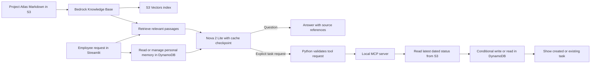

# AWS Bedrock AI | Project Atlas Employee Assistant

A fictional employee assistant that answers questions about a project pilot, remembers a user's response preference, and creates internal follow-up tasks. It demonstrates retrieval-augmented generation (RAG), persistent personal memory, Amazon Bedrock prompt caching, model-selected MCP tools, and duplicate-safe task creation with AWS services.

Project Atlas, its documents, and its tasks are fictional. This is an independent portfolio project.

## What you'll learn

By building and running this project, you'll learn how to:

1. **Build a RAG workflow:** Store project documents in S3, index them in a Bedrock Knowledge Base backed by S3 Vectors, retrieve relevant passages, and use them to answer questions with source references.
2. **Understand embeddings and retrieval:** See how Titan Text Embeddings V2 turns document chunks into vectors and how retrieval supplies context to Nova 2 Lite.
3. **Observe prompt caching:** Add a cache checkpoint to a Bedrock request, then compare cache-write and cache-read tokens across repeated questions.
4. **Connect an AI model to a business action:** Let the model request an MCP tool, validate that request in Python, and create an internal follow-up task only when the user asks for one.
5. **Make actions safe to retry:** Read the latest status from S3 and use a conditional DynamoDB write so repeated requests return the existing task instead of creating duplicates.
6. **Measure the user experience and resource use:** Inspect total latency, time to first answer text (TTFT), approximate output rate, token usage, cache reuse, retrieval time, and tool time in the Streamlit app.
7. **Build personal persistent memory:** Save, retrieve, update, and delete a fictional user's response preference in DynamoDB. Restart the app and switch demo users to verify persistence and separation.

The end result is a small employee assistant that answers from project documents and takes one controlled action. The **Try the demo** and **What to inspect while learning** sections below give you requests to run and code paths to explore.

## What the app does

1. Retrieves relevant Project Atlas passages from an Amazon Bedrock Knowledge Base backed by Amazon S3 Vectors.
2. Sends those passages to Amazon Nova 2 Lite to answer questions with numbered source references.
3. Adds a prompt cache checkpoint after the retrieved context. Bedrock may reuse eligible cached input on a later request.
4. Lets Nova 2 Lite request a local MCP tool when the user explicitly asks to create a task. Python checks the tool request before execution.
5. Reads the latest dated Project Atlas status document from S3, selects the earliest due open action, and creates or returns its internal DynamoDB task.
6. Shows whether the task was newly created or already existed.
7. Streams question answers and displays per-request latency, TTFT, token throughput, prompt cache usage, and resource counts.
8. Stores one controlled response-style preference per fictional demo user in a separate DynamoDB table. The preference changes answer format, while project facts still come from retrieved documents.

## Architecture



The question path uses RAG: the Knowledge Base retrieves passages, and Nova 2 Lite produces an answer grounded in them. A separate DynamoDB table stores only a response-format preference for each fictional user. The app reads that preference before answering and places it after the Bedrock cache checkpoint. Explicit memory commands use DynamoDB directly, without a Knowledge Base or model call. The task path uses a local MCP tool. Task creation reads the current status directly from S3, so it does not rely on a possibly stale retrieved passage. A conditional DynamoDB write prevents duplicates for the same action ID. The app does not email employees or mark the underlying work complete.

## Components

| Component | Purpose |
| --- | --- |
| Streamlit | Local employee interface |
| Amazon S3 | Stores fictional Project Atlas Markdown documents |
| Bedrock Knowledge Base | Retrieves relevant document passages |
| Titan Text Embeddings V2 | Embeds document chunks during ingestion |
| Amazon S3 Vectors | Stores and searches embeddings |
| Nova 2 Lite through Bedrock ConverseStream | Streams answers and selects the task tool |
| Bedrock prompt caching | Makes a stable input prefix eligible for reuse |
| Local MCP Python server and client | Exposes the internal task action |
| Amazon DynamoDB action table | Stores tasks using duplicate-safe conditional writes |
| Amazon DynamoDB memory table | Stores one response-style preference per fictional user |

The Python clients use `ap-southeast-2` (Sydney). Nova 2 Lite uses a global inference profile, which may route inference outside Sydney. Use fictional data for this demonstration.

## Prerequisites

- Python 3.13, Git, and the AWS CLI.
- An AWS profile permitted to use the Bedrock models and resources below.
- Bedrock model access for Nova 2 Lite and Titan Text Embeddings V2.
- A globally unique S3 bucket name for the source documents.

Keep AWS credentials out of the repository.

## Set up AWS resources

1. Create an S3 bucket in Asia Pacific (Sydney). Upload the four files in `knowledge/` under the `project-atlas/` prefix:

   ```bash
   aws s3 sync knowledge/ s3://YOUR_SOURCE_BUCKET/project-atlas/ \
     --exclude "*" --include "*.md" \
     --profile YOUR_AWS_PROFILE --region ap-southeast-2
   ```

2. In the Bedrock console, create a Knowledge Base with an S3 data source at `s3://YOUR_SOURCE_BUCKET/project-atlas/`. This pilot used Titan Text Embeddings V2, 1024-dimensional floating-point embeddings, and quick-created S3 Vectors storage. Sync the data source after creation and whenever a source document changes. Record the Knowledge Base ID.

3. Create the action DynamoDB table in Sydney with the string partition key `action_id` and on-demand billing:

   ```bash
   aws dynamodb create-table \
     --table-name project-atlas-actions \
     --attribute-definitions AttributeName=action_id,AttributeType=S \
     --key-schema AttributeName=action_id,KeyType=HASH \
     --billing-mode PAY_PER_REQUEST \
     --profile YOUR_AWS_PROFILE --region ap-southeast-2
   ```

4. Create a separate memory table with a string partition key `user_id` and string sort key `memory_key`:

   ```bash
   aws dynamodb create-table \
     --table-name project-atlas-memory \
     --attribute-definitions AttributeName=user_id,AttributeType=S AttributeName=memory_key,AttributeType=S \
     --key-schema AttributeName=user_id,KeyType=HASH AttributeName=memory_key,KeyType=RANGE \
     --billing-mode PAY_PER_REQUEST \
     --profile YOUR_AWS_PROFILE --region ap-southeast-2
   ```

Wait until both tables are `ACTIVE`. The AWS profile needs permission to retrieve from the Knowledge Base, invoke Nova 2 Lite, read the source S3 objects, and read/write both DynamoDB tables.

## Run locally

From the repository folder:

```bash
python3 -m venv .venv
source .venv/bin/activate
python -m pip install -r requirements.txt
aws login --profile YOUR_AWS_PROFILE --region ap-southeast-2

AWS_PROFILE=YOUR_AWS_PROFILE \
BEDROCK_KNOWLEDGE_BASE_ID=YOUR_KNOWLEDGE_BASE_ID \
ATLAS_SOURCE_BUCKET=YOUR_SOURCE_BUCKET \
ATLAS_ACTIONS_TABLE=project-atlas-actions \
ATLAS_MEMORY_TABLE=project-atlas-memory \
python -m streamlit run app.py
```

Replace the placeholders with your own values. The local MCP subprocess inherits these environment variables. The S3 source bucket and DynamoDB table names are configurable; the Python code currently fixes the AWS Region to Sydney.

## Try the demo

Enter these fictional requests in the Streamlit app:

- **Question:** `What remains outstanding before the Project Atlas pilot can launch?` Expected: three blockers from the current status, with source references. No task is created.
- **Task:** `Create an internal task for the next open Project Atlas action.` Expected: an IT task for testing sign-in for the remaining 12 volunteers, due 27 October 2026. If that task is absent, the request creates it. If it already exists, the app returns it and says no duplicate was created.
- **Memory:** Select fictional user Alex Morgan and enter `Remember that I prefer short updates with blockers, owners, and due dates.` Expected: the saved style appears under **Personal memory**. Ask the question above; its answer should use a short action-oriented format while keeping source references. Restart the app and confirm Alex's style remains. Switch to Taylor Chen and confirm Taylor has no style. Click **Forget saved preference** for Alex when you want to remove it.

The memory path accepts explicit `Remember that I prefer ...` requests for a short or detailed style. Sending that request saves the preference immediately; there is no separate Save button. It stores a controlled style value, not arbitrary instructions. `What do you remember about me?` shows the saved preference without a model call. **Forget saved preference** appears only when the selected user has a saved style. The current task path accepts explicit requests beginning with `create ` or `please create ` and containing `task`. The latest dated status document must contain action IDs, owner teams, and due dates in the format shown in `knowledge/project-atlas-status.md`.

## Manual end-to-end test script

Start the app with the command in **Run locally**. **Fictional demo user** chooses whose memory to use. **Currently remembered** shows what DynamoDB holds for that user. To save a style, type a remember request in **Your request** and click **Send**. The app supports two fixed styles so it can demonstrate memory without storing arbitrary personal text. There is no style dropdown: when nothing is saved, the page says **Nothing**. Replace the text in **Your request** before each **Send**.

| Step | Action in the page | Expected observation |
| --- | --- | --- |
| 1. Reset | Select **Alex Morgan** and click **Forget saved preference** if it appears. Select **Taylor Chen** and do the same. Return to Alex. | **Currently remembered: Nothing** for each user. This gives the test a known starting point even after an earlier run. |
| 2. Save by prompt | With Alex selected, enter `Remember that I prefer short updates with blockers, owners, and due dates.` in **Your request** and click **Send**. | A confirmation appears, and **Currently remembered** says **Brief bullets with blockers, owners, and due dates**. |
| 3. Inspect | Enter `What do you remember about me?` and click **Send**. | The app reports Alex's brief preference. No Knowledge Base retrieval or Bedrock model call is needed for this memory check. |
| 4. Apply to RAG | Enter `What remains outstanding before the Project Atlas pilot can launch?` and click **Send**. | The answer lists the three open actions from the fictional status document, with source references. It should favor brief bullets with blockers, owners, and exact due dates. Open **How this request ran** and check **Personal memory: Saved response style applied**. |
| 5. Check isolation | Switch **Fictional demo user** to **Taylor Chen**. Enter `What do you remember about me?` and click **Send**. | Taylor shows **Currently remembered: Nothing** and has no saved preference. Alex's memory was not copied to Taylor. |
| 6. Save Taylor's style | With Taylor selected, enter `Remember that I prefer detailed explanations.` in **Your request** and click **Send**. Ask the pilot-launch question from step 4. | Taylor shows the detailed preference. The answer can use more explanation, but its project facts and citations still come from the same documents. |
| 7. Check separation again | Switch back to Alex. | Alex still shows the brief preference; saving Taylor's preference did not change Alex's. |
| 8. Check persistence | Stop Streamlit with `Control+C`, start it again with the same **Run locally** command, and check both users. | Alex still has the brief preference and Taylor still has the detailed preference. The values survived the app process restart because DynamoDB stores them. |
| 9. Forget one user | Select Alex and click **Forget saved preference**. Then check Taylor. | Alex shows **Currently remembered: Nothing** and the Forget button disappears; Taylor still has the detailed preference. |
| 10. Check task action | Enter `Create an internal task for the next open Project Atlas action.` and click **Send** twice. | The page shows the IT sign-in task due **27 October 2026**. The first request creates it only if absent; the second returns the existing task and says no duplicate was created. No email is sent. |
| 11. Inspect caching | Ask the *same* pilot-launch question twice within a few minutes and compare **Cache reused** and the cache-read/cache-write token counts in **How this request ran**. | A repeat may show cache-read tokens. Cache hits are not guaranteed; a cache write alone is not a hit. |

Steps 2, 3, 5, and 9 are memory-only interactions and do not invoke the model. Question and task steps use AWS services and may incur small charges. The model's exact wording can vary, so judge answers by the sourced facts and selected format rather than exact text. The fictional user selector is not authentication; use no real personal data.

To run the offline regression checks from the repository folder, use `python -m unittest discover -s tests -q`. Success ends with `OK`. These tests cover memory save/update/delete, user separation, page restart behavior, and the model/tool integration logic with mocked AWS responses.

## Performance panel

Each request shows total time, cache reuse, and either **TTFT** for a question or **first tool event** for a task request. TTFT is measured on the local client from the start of the streaming model call to its first nonempty text chunk; it excludes Knowledge Base retrieval. A tool-only model response has no answer TTFT, so the page shows when the tool request first arrived instead. The answer appears incrementally as text arrives.

The approximate output rate divides Bedrock's output-token count by the locally measured time after the first text chunk. This is a learning indicator, not a precise model decoding benchmark. It is shown as N/A for a tool-only response.

The **How this request ran** expander shows personal-memory read time, retrieval time, local model-call time, Bedrock-reported model latency, optional MCP task time, uncached input tokens, cache-read and cache-write tokens, output tokens, retrieved chunks, distinct source documents, and call counts. Cache reuse is `cache-read tokens / (uncached input + cache-read + cache-write tokens)`. A cache write is not a cache hit; repeat an identical question soon afterward to observe a possible cache read. [AWS documents](https://docs.aws.amazon.com/bedrock/latest/userguide/prompt-caching.html) the usage fields and cache eligibility rules.

## What to inspect while learning

- **RAG:** `rag_client.py` calls the Knowledge Base Retrieve API. `agent_client.py` puts the returned passages in the model request. The app displays their S3 source URIs so you can check the model's numbered references.
- **Prompt caching:** `agent_client.py` places a `cachePoint` after the retrieved context. Compare cache-write tokens on an eligible first call with cache-read tokens on a repeated call in the page's performance expander. A cache hit is not guaranteed. See [AWS prompt caching documentation](https://docs.aws.amazon.com/bedrock/latest/userguide/prompt-caching.html).
- **Streaming and TTFT:** `agent_client.py` timestamps the first nonempty `contentBlockDelta` text event from `ConverseStream`. The stream's final metadata supplies token usage and Bedrock latency. See the [Nova streaming guide](https://docs.aws.amazon.com/nova/latest/nova2-userguide/streaming-responses.html).
- **MCP and actions:** `mcp_server.py` exposes the tools; `mcp_actions_client.py` calls the task tool; `action_workflow.py` parses the latest S3 status; and `actions_client.py` creates or retrieves the DynamoDB task.
- **Persistent memory:** `memory_client.py` reads and writes the `response_style` item keyed by fictional user ID. `app.py` lets you save, inspect, and forget it. `agent_client.py` reads it on each question and puts it after the cache checkpoint so a changed preference does not alter the earlier cached prefix. Project status is always grounded in retrieved documents.

## Cost and cleanup

This demo can incur charges for model inference, embeddings and ingestion, S3 Vectors, S3 storage and requests, and DynamoDB operations. Cache writes and reads can have different rates from uncached model input. Review current [Bedrock pricing](https://aws.amazon.com/bedrock/pricing/), [S3 pricing](https://aws.amazon.com/s3/pricing/), and [DynamoDB pricing](https://aws.amazon.com/dynamodb/pricing/) for your Region and account before extended use. AWS credits and eligibility vary by account.

When finished, remove the demo Knowledge Base and its vector resources, source S3 objects and bucket, and both DynamoDB tables through the AWS console. Check the resource lists and billing page afterward; deleting the Knowledge Base may not remove every associated resource.

## Limits

- The assistant uses fictional documents and runs locally. It does not connect to a real employee directory, ticketing system, or messaging service.
- The model can produce an inaccurate answer or citation; check claims against the displayed sources.
- The action parser expects the documented status format. It does not accept arbitrary prose or automatically close tasks when a newer status changes.
- Creating a task does not mean the underlying action is complete.
- The fictional user selector is for learning, not authentication. Anyone with access to this local app can switch demo users; do not use it with real personal information.
- Personal memory is limited to one of two response styles. The app does not infer and save arbitrary facts from conversations.
